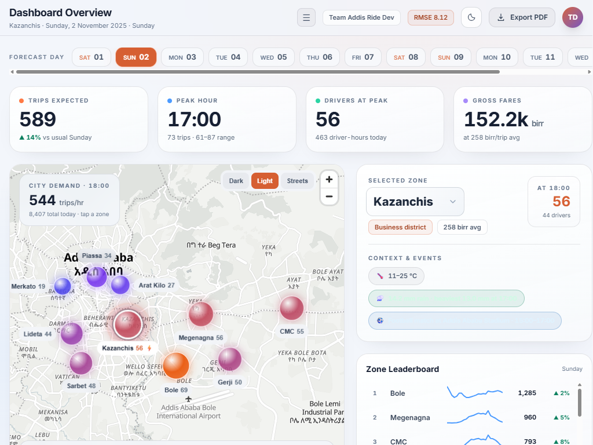

# Addis Ababa Ride Demand Forecast

**Team Addis Ride Dev** · Qiyas AI Hackathon #2 · Addis Ababa University

Forecast hourly ride-hailing demand across 12 Addis Ababa zones for **1–14 November 2025**. The project combines historical trips with prepared weather, event, calendar, and zone features, then serves the forecasts through an interactive dashboard.

<p align="center">
  
  
  
  
</p>

## 📊 Dashboard



The dashboard combines zone-level forecasts, driver planning, expected fares, weather inputs, and confirmed events. Dates are limited to the model's prepared **1–14 November 2025** forecast horizon.

## ✨ Highlights

- **Forecast quality:** LightGBM with a Poisson objective; validation RMSE **8.12 trips per zone-hour**.
- **12-zone view:** Interactive Addis Ababa map and daily zone ranking.
- **Operations view:** Hourly forecasts, peak demand, driver estimates, shift summaries, and expected gross fares.
- **Forecast context:** Weather inputs and confirmed events for the selected zone or citywide.
- **Exports and accessibility:** One-page PDF forecast brief, hourly CSV, and light/dark themes.
- **Uncertainty:** 80% and 90% prediction intervals for forecast hours.

## 🚀 Quick start

Requirements: **Python 3.10+**. The committed web build is served by FastAPI, so Node.js is not required to run the dashboard.

```bash
git clone https://github.com/Ab-xo/addis-ride-forecast.git
cd addis-ride-forecast

python -m venv .venv
# Windows:
.venv\Scripts\activate
# macOS/Linux:
# source .venv/bin/activate

python -m pip install -r requirements.txt
python app/app.py
```

Open **<http://localhost:8000>**. To start on a specific zone and forecast date, use a link such as:

```text
http://localhost:8000/?zone=Kazanchis&date=2025-11-02
```

The date selector uses the model's fixed forecast horizon; users do not supply weather or event values.

### Develop the web interface (optional)

Node.js 20+ is only needed when changing the Next.js interface:

```bash
cd app/web
npm install
npm run dev
```

Keep `python app/app.py` running for the API, then open <http://localhost:3000>. Run `npm run build` to refresh the static build served from `app/web/out/`.

## 📈 Model and evaluation

| Metric | Result |
|---|---:|
| Held-out RMSE (18–31 October 2025) | **8.12** trips per zone-hour |
| Held-out MAE | **5.61** trips per zone-hour |
| Five-fold rolling-origin RMSE | **8.68 ± 0.79** |
| Seasonal-naive baseline RMSE | 9.94 |
| Forecast-time features | 40 |

Validation uses chronological splits; the test file is not used to calculate these scores. The final model improves RMSE by about **18%** over the seasonal-naive baseline. Weather and events are forecast-time inputs, alongside calendar, zone, holiday-window, and historical-demand features. The dashboard displays the matching prepared inputs and confirmed event windows for the selected forecast date.

Prediction intervals were calibrated on 4–17 October and evaluated on 18–31 October: empirical coverage was **79.8%** for the nominal 80% interval and **89.6%** for the nominal 90% interval.

Full comparisons and methodology:

- [Model evaluation](reports/D_model_evaluation.md)
- [Uncertainty analysis](reports/D_stretch_uncertainty.md)
- [Cleaning and integration](reports/A_cleaning_and_integration.md)
- [Data analysis](reports/B_analysis_report.md)

## 🔁 Reproduce the results

After installing `requirements.txt`, execute the notebooks in order from the repository root:

```bash
cd notebooks
jupyter nbconvert --to notebook --execute --inplace 01_cleaning_and_integration.ipynb
jupyter nbconvert --to notebook --execute --inplace 02_analysis_report.ipynb
jupyter nbconvert --to notebook --execute --inplace 03_visualizations.ipynb
jupyter nbconvert --to notebook --execute --inplace 04_modeling_and_evaluation.ipynb
cd ..

python -m src.predict
python -m src.app_assets
```

The notebooks clean and integrate the source tables, perform analysis, create figures, and evaluate models. The scripts generate predictions and refresh the lookup assets bundled with the demo. Random seeds and input paths are configured in the project for reproducibility.

## 🧭 Project layout

| Path | Purpose |
|---|---|
| `app/app.py` | FastAPI forecast API and static dashboard server |
| `app/web/` | Next.js dashboard source and built static site |
| `app/assets/` | Model and lookup data used by the dashboard |
| `src/` | Data cleaning, features, training, prediction, and app assets |
| `notebooks/` | Cleaning, analysis, visualizations, and model evaluation |
| `data/raw/` | Original synthetic training data |
| `data/processed/` | Cleaned and integrated datasets |
| `models/` | Final trained model and parameters |
| `reports/` | Evaluation, analysis, cleaning, and uncertainty reports |
| `submission/` | Forecast submission and prediction intervals |
| `figures/` | Generated figures and captions |

## 👥 Team

| Name | Student ID |
|---|---|
| Abraham Gebeyehu | qiyas-2026-004484 |
| Bethelhem Legesse | qiyas-2026-000286 |
| Eden Kibret | qiyas-2026-000721 |
| Eleni Andualem | qiyas-2026-000054 |
| Feven Abebe | qiyas-2026-003641 |
| Surafel Solomon | qiyas-2026-007128 |

## ℹ️ Data and scope

All project data is synthetic and was supplied for training by the hackathon organizers. The dashboard scores the prepared model inputs for the original November 1–14, 2025 horizon; it does not generate forecasts for arbitrary dates.
